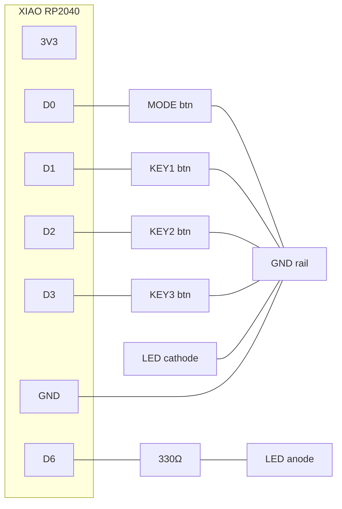

# PCB DESIGN — custom carrier board (Tier 2)

A small 2-layer carrier PCB that turns the breadboard rig into a product: the
XIAO RP2040 solders on via castellated pads, four tactile buttons + a status
LED mount directly on the board, and you plug the XIAO's own USB-C into the
host (or add a board-edge cutout for a panel jack).

> **Honesty up front:** these are *design documents* — a complete, buildable
> spec (schematic, netlist, placement, routing, fab + order steps). They are
> **not** machine-generated Gerbers. I can't run KiCad in this environment to
> plot and DRC-verify a board, so recreate this in KiCad (≈30 min with the spec
> below) or hand it to a layout service. Say the word and I'll generate KiCad
> source files for you to open and plot. **Do a DRC + visual check before you
> order — don't send unverified Gerbers to a fab.**

---

## Schematic



**Electrical summary**
- 4× tactile switches, each: one side → signal (D0/D1/D2/D3), other side → GND.
  Internal MCU pull-ups are used, so **no external pull-up resistors**.
- 1× LED + 1× 330Ω series resistor from D6 to GND.
- No external power components — the XIAO is powered by USB.

---

## Netlist (connection table)

| Net | Pins on net |
|-----|-------------|
| `GND` | XIAO.GND, SW0.2, SW1.2, SW2.2, SW3.2, R1? (no), LED.K |
| `D0` | XIAO.D0, SW0.1 |
| `D1` | XIAO.D1, SW1.1 |
| `D2` | XIAO.D2, SW2.1 |
| `D3` | XIAO.D3, SW3.1 |
| `D6` | XIAO.D6, R1.1 |
| `LED_A` | R1.2, LED.A |
| `3V3` | XIAO.3V3 (unused — optional test pad) |

(SWx.1/.2 = the two electrically-distinct sides of a 4-pin tactile switch; tie
the two same-side pins together as the footprint does.)

---

## Board outline, placement & stackup

- **Stackup:** 2-layer, 1.6mm FR-4, 1oz copper, HASL (cheapest) or ENIG.
- **Outline:** ~45mm × 25mm rounded-rect (fits a 100×60 box with room, or design
  a matching 3D-printed shell). Adjust to your enclosure.
- **XIAO footprint:** two rows of 7 castellated pads @ 2.54mm pitch, rows
  17.78mm (700mil) apart — use the community "Seeed XIAO" footprint (many KiCad
  libraries ship it; or the official Seeed KiCad library). Place it centered so
  the USB-C end is at a board edge.
- **Buttons:** 6mm tactile (6×6mm, 4-pin, 2.54/4.5mm footprint) OR pads for your
  12mm panel buttons wired off-board. Space ≥ their body + finger clearance.
- **LED + R1:** place the LED at a board edge/corner so it's visible; R1 right
  next to D6.

```
   ┌──────────────── ~45 x 25 mm ─────────────────┐
   │  (K1)   (K2)   (K3)                 (LED)      │
   │   []     []     []                   *         │
   │                                     [R1]       │
   │        ┌───────── XIAO RP2040 ──────────┐      │
   │        │  :::::::::  (castellated)  ::::: │      │
   │ USB-C  │                                 │      │
   │ edge ◄─┤  USB-C connector at this edge   │      │
   │        └─────────────────────────────────┘      │
   │  (MODE)                                        │
   │    []                        ○ mount   ○ mount │
   └────────────────────────────────────────────────┘
```

- **Mounting holes:** 2–4× M2 (2.2mm drill, ~4mm pad keep-out) in the corners.

---

## Routing guidance (2-layer, trivial board)

- All nets are low-speed logic — **no impedance control, no length matching.**
- **Trace width:** 0.3–0.4mm signals, 0.5mm+ for GND runs. Everything fits at
  these widths with margin.
- Put a **GND pour on the bottom layer**; stitch button grounds into it.
- Keep the USB-C area clear of copper you don't need; the XIAO handles USB.
- Run signals on top, jumper through the pour on the bottom only where needed.
  With this few nets you can likely route top-only + a bottom GND pour.

---

## Fabrication & assembly

1. In KiCad: draw the schematic → assign footprints → netlist → lay out per
   above → **run DRC** → plot Gerbers + drill → generate the BOM + a 3D preview.
2. Zip the Gerbers. Order from **JLCPCB / PCBWay / OSHPark** (2-layer, 1.6mm,
   HASL, qty 5 is the usual minimum, ~$2–15 + shipping).
3. Assembly is hand-solderable: tack the XIAO on its castellated pads, then the
   buttons, R1, and LED. No hot-air or stencil needed.

## PCB BOM (per board)

| Ref | Part | Qty | Footprint |
|-----|------|-----|-----------|
| U1 | Seeed XIAO RP2040 | 1 | XIAO castellated (2×7, 2.54mm) |
| SW0–SW3 | 6mm tactile switch (or wires to panel buttons) | 4 | TACT_6x6_4pin |
| D1 | LED (3mm/5mm or 0805 SMD) | 1 | your choice |
| R1 | 330Ω resistor | 1 | 0805 SMD or THT ¼W |
| H1–H4 | M2 mounting holes | 4 | 2.2mm |

---

## Why this is "trivial" as PCBs go (confidence)

- Only 7 nets, all slow digital, powered over USB — **no analog, no high-speed,
  no power regulation**. The layout risk is very low. **Confidence: high** that
  the *electrical design* is correct (it mirrors the breadboard rig that the
  firmware targets).
- **Confidence note / caveat:** I did not plot or DRC these in KiCad here, and
  the XIAO castellated footprint + your chosen button/LED footprints must come
  from a real library — get those from the **official Seeed KiCad library** or a
  trusted community one, and verify pad pitch against the datasheet before
  ordering. Treat the first board (qty 5) as a prototype run.
- If you'd rather not touch KiCad, I can instead target a ready-made **XIAO
  expansion/proto board** and give you a solder-map — ask and I'll spec it.
